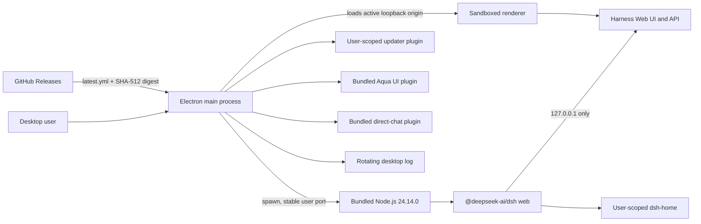

# Architecture

## Process model

The Electron main process owns the Harness child process. It launches `dsh --profile web --patch <desktop-updater-patch> --host 127.0.0.1 --port <stable-user-port> --no-open`, parses the address reported by the upstream CLI, retains the one-time authentication token, accepts the cookie-issuing same-origin redirect, and only then navigates the desktop window to that origin. The per-user port remains stable so origin-scoped Web UI settings and wallpaper data survive restarts. If that port is temporarily occupied, the current launch falls back to another loopback port without replacing the saved preference. App shutdown terminates the child process tree.

## Runtime layout

The build keeps desktop and Harness dependencies separate:

- The root package contains Electron and electron-builder as development dependencies.
- `runtime/package.json` pins production dependencies used by Harness.
- `scripts/prepare-runtime.ps1` uses `pnpm deploy --prod` to produce a self-contained `build/runtime` tree.
- electron-builder stores that production tree under `resources/harness`, with the pinned `node.exe` under `resources/runtime`.

Separating the runtime prevents Electron build tooling from being shipped to users and keeps native Harness modules outside `app.asar`, so they are loaded by the matching standalone Node.js runtime instead of Electron's Node ABI.

## Data and upgrades

Program files are read-only at runtime. Harness data is placed under Electron's user-data directory in `dsh-home`; updater preferences, the stable Harness port, and window placement live in `desktop-settings.json`; diagnostics go to `logs/desktop.log`. Window geometry is restored only when it remains visible on a connected display. On the first v0.0.2 launch, the legacy `DeepSeek Harness Desktop` directory is moved to `DeepSeek Harness` when safe. The installer does not delete application data during uninstall.

The desktop updater itself is an Electron main-process service backed by `electron-updater`. A narrow preload bridge exposes only update state, the enabled preference, and a manual check command. A bundled Harness plugin renders these controls in General Settings. Checks use the GitHub Releases `latest/download` endpoint directly, start ten seconds after launch, repeat every six hours when enabled, and retry transient check or download failures twice. Downloaded updates can install immediately or on exit.

The Aqua transparent UI package is pinned in the production runtime. On startup, the desktop main process copies its runtime files into the Web profile and registers the local package with `dsh plugin --offline`, so first use and version upgrades never depend on npm or GitHub availability.

The direct-chat plugin follows the same offline deployment path. A pinned patch renders the upstream `sidebar.footer.action` slot immediately after the workspace browser instead of inside the bottom footer; the plugin registers its workspace-style chat section there, while Settings stays pinned to the bottom. New Chat calls the Sessions runtime with an empty payload; the Harness Host then creates a real session in its default directory. A direct-chat composer takeover removes the upstream blank-session workspace lock while retaining the same session input machine, prompt pipeline, transcript, and configured model.

## Security choices

- Loopback-only binding keeps the service private, while a validated per-user port preserves origin-scoped UI state across launches.
- The renderer uses `contextIsolation: true`, `nodeIntegration: false`, `sandbox: true`, and `webSecurity: true`.
- Browser permission requests and webviews are denied.
- Navigation is limited to `file:` startup pages and the exact current Harness origin.
- External links accept only HTTP(S) and open in the operating system browser.
- API keys and session data are never copied into the source tree or release artifacts.
- Update checks are pinned to `Icdafy/DeepSeek-Harness-Desktop`; arbitrary update URLs are not exposed to the renderer.

## Release integrity

Each tag build runs tests, performs a packaged portable-app smoke test, and publishes SHA-256 hashes plus electron-updater metadata and an NSIS blockmap. GitHub also attaches source archives generated from the release tag. Current releases are unsigned; future production releases should add Authenticode signing without weakening checksum publication.

## v0.0.9 upstream compatibility and deletion

The production runtime pins official Harness 0.1.5-rc.1. The three UI patches are rebased to that release. Aqua's defineStore import now targets client-store; its peer declarations are aligned before dependency resolution by .pnpmfile.cjs. Desktop plugin cards use a dedicated Plugins tab because upstream settings.plugin.item is now keyed by Host settings namespaces. Offline installation compares bundled file contents as well as version numbers, so a compatibility patch also updates an existing Aqua installation.

Permanent deletion is exposed through a sender-validated Electron IPC method. The host plugin checks session existence and rejects when a session is running, then flushes persistence over a private child-process IPC channel. The desktop stops the local host before removing the selected session directory (including all immutable generations), drops derived transcript caches and workspace references, then restarts the host and reauthenticates the renderer. Only session IDs are accepted from the page; filesystem roots come from the host and must remain inside dsh-home without junctions or symbolic links. Project files, independent forks and shared attachments remain intact.

Smoke tests use a fresh temporary user-data directory and the real sandboxed Electron renderer. They exercise the sidebar, empty-session menu, durable rename, permanent deletion, preservation of a second session, and reload. No user conversation or model credentials are needed for this validation.

## v0.0.11 upstream synchronization

The runtime now pins official Harness `0.2.1-alpha.2`, corresponding to the latest release merge on the official repository's master branch, `d743267388641bc76f17c45ce8b4c231aed1d32c` (2026-10-09). This deliberately follows the newest GitHub release, ahead of npm's `latest` channel (`0.2.0-rc.2` at verification on 2026-10-12).

Desktop UI patches target the exact new package versions. The workspace patch preserves upstream's default/show/only archive-filter behavior while filtering direct chats. Aqua uses client-store, exact matching Harness peers and Cordis `~4.0.5-alpha.1`; its obsolete invariant export and peer are removed. Runtime preparation checks the deployed Harness version against `runtime/package.json` before packaging.

Upstream's current Session format is V4. Its persistence catalog owns historical migration; the desktop continues to use the same user-data directory and never rewrites session transcripts itself. Older runtimes cannot read newly written V4 content.

Direct-chat navigation and archiving now use `uiWorkspace`, current selection follows the Session catalog's `retainedBy.mainView`, and rename borrows a Session reference with `sessions.using`. Both desktop chat and Aqua use the new Regular icon exports. Smoke checks also open the native composer, verify upstream's rejection of forks without a completed turn, archive a chat while retaining its sibling, render desktop update/plugin settings and toggle Aqua; updater checks in smoke mode use a non-networking development controller.

## v0.0.12 workspace deletion and directory validation

The desktop chat plugin contributes a destructive entry to `sidebar.workspaces.session.menu.item` and a confirmation dialog to `shell.overlay`. The request survives closing the row menu, and this registration is independent of the direct-chat section's enabled preference. The pinned workspace UI patch exposes actions on the selected blank Session too. Workspace and direct-chat deletion share the same validated Electron IPC path.

Projection caches now use the storage-domain per-record layout. Permanent deletion removes `storages/session_projcache/sessions/<id>.json` for the selected Session in addition to the legacy cache, persisted log directories, workspace references and SQLite query sidecars. Other per-record caches and project files are preserved.

Startup navigation selects a recent workspace and may create a blank Session. Upstream's `ApiSessionAgentController.createOrAdopt` unconditionally called `mkdir(cwd, { recursive: true })`, silently recreating a directory removed outside Harness. The pinned API Session patch replaces that call with `stat(cwd)` and an existing-directory check, in both the bundled runtime and the module used by regression tests. Missing directories reject creation with a choose-workspace message. Resuming existing history continues through the upstream resume path; explicit directory creation and first-use default workspace initialization retain their own separate APIs.

Smoke mode seeds two workspace registrations in a fresh temporary application directory: one existing project with a sentinel file and one removed desktop-style directory. It verifies startup refusal, workspace blank-Session cancellation/deletion, on-disk absence, sibling and project-file preservation, per-record cache removal and reload. Tests never open or modify real user workspace data.
